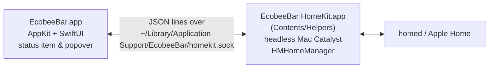

# EcobeeBar

A native macOS menu bar app for the ecobee thermostats in your **Apple Home**. It uses Apple's HomeKit framework, so the thermostats stay in Apple Home, Siri, and Home automations on your iPhone and keep working there. It doesn't use the ecobee cloud or an API key, and nothing needs to be re-paired or reset.


## Features

- Menu bar item shows the room temperature, plus a flame or snowflake icon while the system is heating or cooling.
- Popover controls:
  - Setpoint slider and −/+ buttons (whole °F or half °C steps).
  - Separate heat and cool thresholds in Auto mode.
  - Mode (Off/Heat/Cool/Auto), fan (Auto/Always On), and a power toggle that restores the last mode.
  - Comfort profile and an Away toggle, on ecobee models whose firmware reports them correctly. The ecobee3 lite doesn't, so they're hidden there.
  - Humidity, and the temperature and occupancy of remote room sensors.
- Live updates through HomeKit notifications.
- Every thermostat in every home you can access, switched from the name in the popover header.

## How it works

A Mac app can't use HomeKit unless it's a Mac Catalyst (UIKit) app, and Catalyst can't host an AppKit menu bar popover in the same process: SwiftUI resolves to its UIKit variant there. So EcobeeBar is two processes:



- The menu bar app launches the helper, reconnects to it if it goes away, and stops it on quit.
- The helper exits on its own 10 s after the menu bar app disconnects.
- Only the helper carries the HomeKit entitlement.

## Requirements

- macOS 14 or later, signed in to iCloud with Home enabled. Your thermostats must already show up in the Home app.
- Xcode, signed in to an Apple ID, for provisioning only. The build itself works with just the Command Line Tools.
- **A signing identity and provisioning profile with the HomeKit capability.** `homed` rejects any process that lacks the `com.apple.developer.homekit` entitlement, and that entitlement only works with a provisioning profile. `scripts/provision.sh` gets both from Xcode.

## Build & run

```sh
scripts/provision.sh       # once (and again when the profile expires)
scripts/bundle.sh          # picks up build/signing.env from provision.sh
open build/EcobeeBar.app
```

Without a profile, `scripts/bundle.sh` still builds, but the app only explains that HomeKit signing is required.

On first launch macOS asks whether EcobeeBar can access your Home data. Click **Allow**.

## Signing

One-time setup:

1. Install Xcode, then make it the active developer directory: `sudo xcode-select -s /Applications/Xcode.app`.
2. In Xcode → Settings → Accounts, add your Apple ID.
3. Run `scripts/provision.sh` to list the paid teams Xcode knows about, then `TEAM_ID=… scripts/provision.sh` with yours. The script never picks a team on its own, because the account may also belong to an organization's team.

The script builds a throwaway Mac Catalyst app (`dev/provisioning/`) with automatic signing and `-allowProvisioningUpdates`. That makes Xcode create the Apple Development certificate, an explicit App ID with HomeKit, and a Mac Catalyst development profile that includes this Mac. It saves the profile to `build/HomeKit.provisionprofile` and the identity to `build/signing.env`.

**This needs a paid Apple Developer Program team.** A free Personal Team fails with "Entitlement com.apple.developer.homekit not found and could not be included in profile". Apple offers HomeKit to free accounts for iOS apps only, not Mac Catalyst. Paid profiles last a year; when one expires, rerun `scripts/provision.sh && scripts/bundle.sh`.

The helper's bundle ID defaults to `com.jacobcoffee.EcobeeBar.HomeKit`; override it with `HELPER_ID=…`. Bundle IDs are global, so a different team needs its own.

To sign by hand instead, set `SIGN_IDENTITY="Apple Development: …"` and `HOMEKIT_PROFILE=path/to/profile` for `scripts/bundle.sh`.

## Development

```sh
scripts/test.sh                                   # unit tests (socket framing, setpoint clamping)
uv run --with HAP-python dev/fake_thermostat.py   # simulated ecobee, setup code 123-45-678
```

To test without touching your real thermostats, add the fake one to Apple Home (Home app → Add Accessory → More options). It has a fan, ecobee's comfort-profile characteristics, and a remote sensor, and it drifts the room temperature so you can watch HVAC activity.

An earlier version talked to the thermostat directly over the HomeKit Accessory Protocol, which required removing it from Apple Home. It's preserved in the first git commit.

## Layout

```
Sources/EcobeeKit  shared model + socket protocol (built into both processes)
Sources/EcobeeBar  menu bar app (AppKit status item + SwiftUI popover)
Helper/            Mac Catalyst HomeKit helper (built by scripts/bundle.sh)
```
